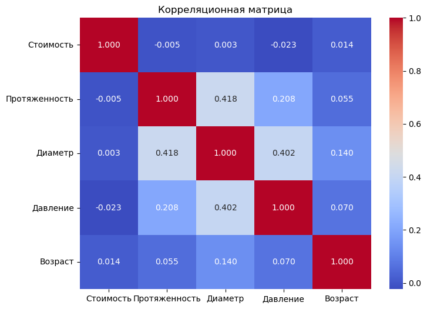
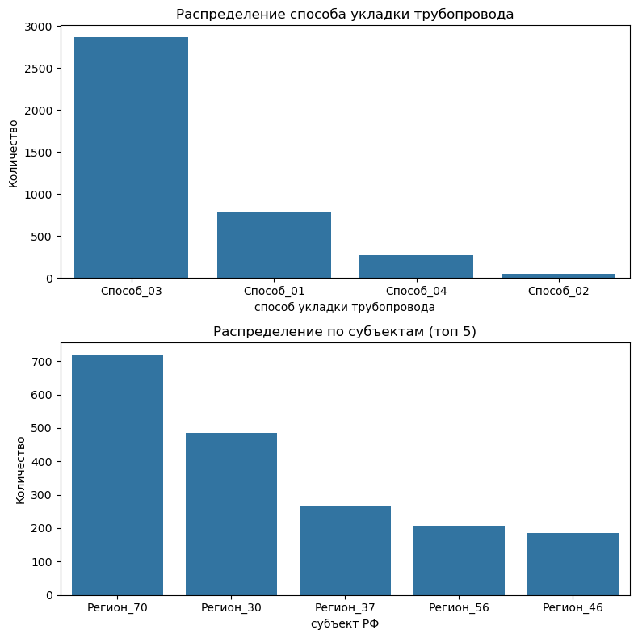
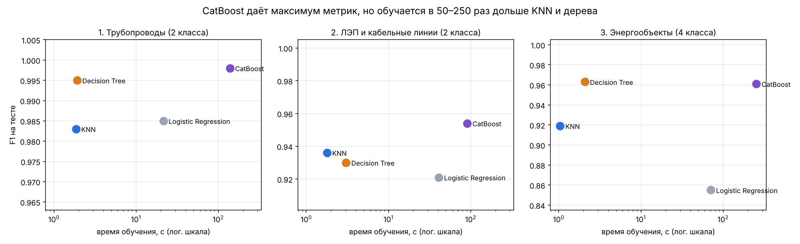
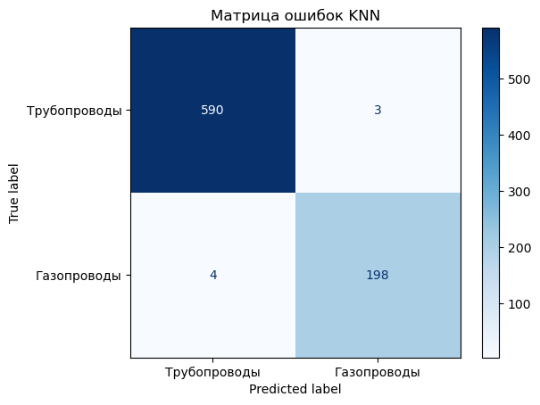

# Классификация основных средств по характеристикам — курсовая, 7 семестр

Курсовая по дисциплине «Методы и средства интеллектуального анализа данных в экономике» (СПбГЭУ, 2025).
Данные — выгрузка реестра основных средств газовой компании, по которой я потом писал диплом:
[fixed-assets-classification-thesis](https://github.com/chigerokii/fixed-assets-classification-thesis).
Здесь задача уже, чем в дипломе: классы различаются по техническим характеристикам, а не по тексту названия.

Данные не публикуются: это внутренний ресурс компании. В репозитории есть текст постановки, итоговые метрики и графики.
На графиках регионы и способы укладки уже обезличены (`Регион_70`, `Способ_03`).

## Задача

Восемь классов объектов я свёл в три выборки по набору общих признаков:

| Выборка | Классы | Числовые признаки | Категориальные |
|---|---|---|---|
| 1 | внутрипромысловые трубопроводы, магистральные газопроводы (с лупингами и отводами) | стоимость, протяжённость, диаметр, давление, возраст | субъект РФ, способ укладки, организация |
| 2 | кабельные линии и ЛЭП | стоимость, протяжённость, напряжение, возраст | субъект РФ, организация |
| 3 | компрессорные станции, дизельные электростанции, ДКС, трансформаторные подстанции | стоимость, мощность, возраст | субъект РФ, организация |

Возраст я посчитал от даты ввода в эксплуатацию. Пропуски и нули заполнял медианой или модой внутри групп
(субъект × способ укладки), а не по всей таблице. Так у трубопровода в болотистом регионе не появится давление,
типичное для другого региона. Выбросы не удалял: огромные магистрали — не ошибка, а часть класса.

## Что показал EDA

Распределения сильно скошены, а линейных связей почти нет. Поэтому я смотрел корреляцию Спирмена.
Самая сильная связь — диаметр с протяжённостью и давлением, около 0,4. Стоимость почти ни с чем не связана.
Отсюда вывод: один признак класс не определяет. Нужны модели, которые ловят нелинейные границы.
Для ЛЭП и энергообъектов картина та же: [ЛЭП](images/corr_power_lines.png), [энергообъекты](images/corr_energy_objects.png).

Категориальные признаки распределены очень неравномерно: один способ укладки покрывает ~70% трубопроводов.
Но по классам они слегка смещены, поэтому я их оставил.

## Модели

Пайплайн одинаковый для всех выборок: `StandardScaler` + `OneHotEncoder` → `SMOTE` → модель.
SMOTE стоит внутри пайплайна imblearn, поэтому синтетические объекты появляются только на обучающих фолдах, тест остаётся чистым.
Гиперпараметры подбирал `GridSearchCV` на `StratifiedKFold`, с отдельной сеткой для каждой модели и для `k_neighbors` у SMOTE.

Сравнивал четыре модели: логистическую регрессию (l1/l2/elasticnet), KNN, дерево решений и CatBoost.

## Результаты

| Выборка | Модель | Время, с | ROC-AUC | Accuracy | F1 |
|---|---|---:|---:|---:|---:|
| 1 | Logistic Regression | 21,5 | 0,999 | 0,992 | 0,985 |
| 1 | KNN | 1,9 | 0,997 | 0,991 | 0,983 |
| 1 | **Decision Tree** | 1,9 | 1,000 | 0,997 | 0,995 |
| 1 | CatBoost | 138,2 | 1,000 | 0,999 | 0,998 |
| 2 | Logistic Regression | 40,9 | 0,965 | 0,900 | 0,921 |
| 2 | **KNN** | 1,8 | 0,971 | 0,917 | 0,936 |
| 2 | Decision Tree | 3,1 | 0,938 | 0,909 | 0,930 |
| 2 | CatBoost | 90,8 | 0,982 | 0,941 | 0,954 |
| 3 | Logistic Regression | 70,9 | 0,965 | 0,850 | 0,855 |
| 3 | KNN | 1,0 | 0,986 | 0,920 | 0,919 |
| 3 | **Decision Tree** | 2,1 | 0,991 | 0,963 | 0,963 |
| 3 | CatBoost | 254,3 | 0,997 | 0,961 | 0,961 |

Главный вывод — про цену качества, а не про то, какая модель выиграла:

- **Трубопроводы** разделяются почти идеально любой моделью: диаметр и давление у магистрали и промысловой трубы
  слишком разные. CatBoost добавляет 0,3 п.п. F1 к дереву и обучается в 72 раза дольше.
- **ЛЭП** — единственная выборка, где CatBoost заметно лучше: +1,8 п.п. F1 к KNN. Его время — 51×.
  Если ошибка в классе стоит дорого, тут бустинг оправдан.
- **Энергообъекты** (4 класса): дерево не хуже CatBoost (0,963 против 0,961) и в 123 раза быстрее.
  Логистическая регрессия отстаёт на 11 п.п.: границы между станциями по мощности и стоимости явно нелинейные.

На трубопроводах KNN ошибся в 7 случаях из 795. ROC-кривые: [трубопроводы](images/roc_pipelines.png),
[ЛЭП](images/roc_power_lines.png), [энергообъекты, one-vs-rest для дерева](images/roc_energy_objects_dt.png).

## Код

| Ноутбук | Что внутри |
|---|---|
| [`01_pipelines.ipynb`](notebooks/01_pipelines.ipynb) | трубопроводы: регион из адреса регулярками, заполнение пропусков внутри групп, EDA, модели |
| [`02_power_lines.ipynb`](notebooks/02_power_lines.ipynb) | кабельные линии и ЛЭП |
| [`03_energy_objects.ipynb`](notebooks/03_energy_objects.ipynb) | 4 класса энергообъектов, VIF и хи-квадрат для категориальных признаков |

Выводы ячеек удалены: в них были строки исходной таблицы. Справочники «организация → код» и «регион → код»
вынесены в непубликуемые файлы, поэтому ноутбуки без данных не запустятся. Они показывают ход работы.

## Ограничения

- Метрики на первой выборке слишком хорошие, чтобы ими хвастаться: задача там простая.
  Интереснее вторая и третья выборки.
- Время — это время одного запуска на ноутбуке. Для сравнения порядков оно годится, для точных цифр нет.
- Классы внутри выборки выбраны заранее. В реальном реестре сначала нужно понять, к какой группе относится объект.
  Эту проблему решает уже диплом: там классификация идёт по тексту названия на сотни классов.

## Стек

Python, pandas, scikit-learn, imbalanced-learn (SMOTE), CatBoost, seaborn, plotly.

---

**EN.** Term paper (7th semester): classifying fixed assets of a gas company (pipelines, power lines, energy facilities)
from technical attributes. One pipeline (scaling + one-hot → SMOTE → model, GridSearchCV with stratified CV) for logistic
regression, KNN, decision tree and CatBoost. Key finding: CatBoost tops the metrics, but takes 50–250× longer to train for
−0.2…+1.8 pp of F1, so a decision tree or KNN is the practical choice. The data is internal and not published.
